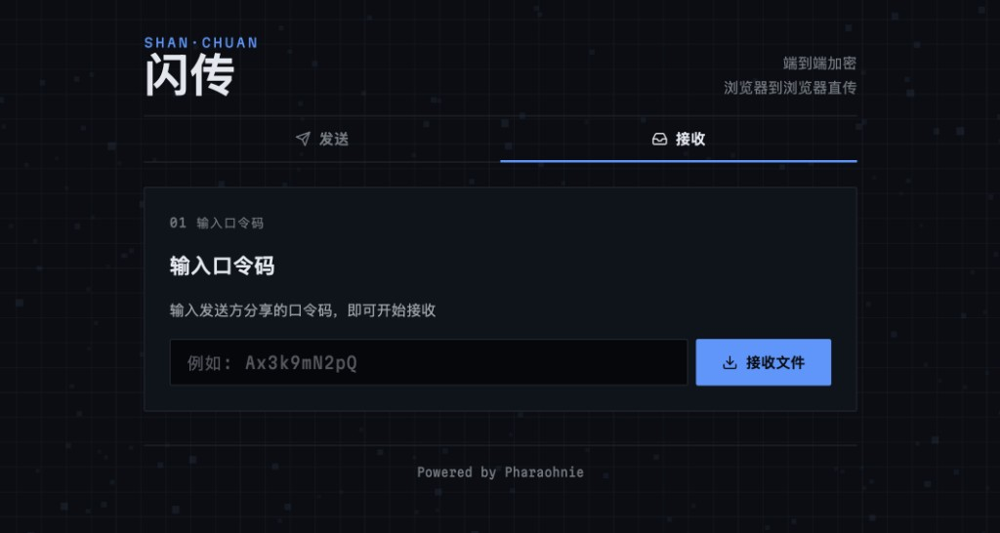

# 闪传

浏览器端到端加密文件传输工具。发送方与接收方通过口令配对，数据经 PAKE 协商密钥后 AES-GCM 加密传输；优先尝试 WebRTC 点对点直连，不可用时自动降级到中继转发。



## 功能特点

- **端到端加密**：PAKE 口令认证 + AES-GCM 加密，中继服务器无法解密文件内容（仅浏览器的文件/文本传输走此路径）
- **批次完整性校验（协议 v2）**：发送前先传一份加密文件清单，接收端只接受清单内的序号，缺失、重复或字段不符会报错并列出缺了哪些文件；对端版本较旧时回退 v1，并明确提示“未校验文件清单”
- **口令与房间 ID 解耦**：加入房间时发送口令哈希，降低口令明文暴露面
- **智能传输路径**：STUN 直连优先，可选 TURN 提升跨网段成功率，失败时回退 WebSocket 中继
- **多文件与文本**：支持拖拽多选文件、纯文本发送；接收方可流式下载大文件
- **命令行下载（服务端开启后自动生成）**：单个文件发送时会自动给出一条 `curl` 命令，下载一次后服务端立即删除（见[下文](#命令行下载curl)）
- **零账号**：无需注册登录，分享口令即可传输
- **安全加固**：限流防暴力枚举、CSP 安全头、文件名消毒、AAD 绑定防篡改、公网 `ws://` 明文拦截

## 安全边界（威胁模型）

- **保护**：不知道口令的中继或网络观察者无法解密文件内容，也无法冒充对端；文件分块与元数据都用 AAD 绑定到会话，篡改会解密失败。
- **不保护**：口令本身泄露、端点被控、屏幕录制。PAKE 不能阻止“先录下加密流量、再离线爆破口令、最后解密旧流量”的路径。
- roomId 目前由口令的 SHA-256 派生，12 位口令约 71.5 bit。中继日志里的 roomId 是一个可离线验证口令的哈希；协议 v2 计划改用慢 KDF 或随机房间令牌，取舍见 [docs/protocol-v2.md](docs/protocol-v2.md)。
- curl 分享是服务端明文暂存，端到端加密不覆盖这条路径；该功能默认关闭。

## 环境要求

| 依赖 | 版本 |
|------|------|
| [Go](https://go.dev/dl/) | 1.26+ |
| [Node.js](https://nodejs.org/) | 18+（仅运行测试时需要） |

## 快速开始

### 1. 克隆仓库

```bash
git clone <repo-url> croc-wasm
cd croc-wasm
```

### 2. 构建

```bash
./build.sh
```

构建产物：

- `relay/relay-server` — WebSocket 中继服务（同时托管前端静态资源）
- `public/croc.wasm` — Go 编译的加密 WASM 模块
- `public/wasm_exec.js` — Go WASM 运行时

### 3. 启动服务

```bash
cd relay && ./relay-server
```

默认监听 `http://localhost:8154`，在浏览器打开该地址即可使用。

配置文件位于项目根目录 `config.yaml`（首次部署请复制 `config.example.yaml` 并填写生产值；`config.yaml` 不纳入版本库）。中继启动时会自动查找，也可手动指定：

```bash
./relay-server -config ../config.yaml
```

### 4. 使用流程

**发送方**

1. 点击「发送」，选择文件或输入文本
2. 点击「开始发送」，复制生成的口令码
3. 将口令码分享给接收方，等待传输完成
4. 服务端开启 `share.enabled` 后，单个文件会自动生成 `curl` 下载命令，见下一节

**接收方**

1. 点击「接收」，输入发送方分享的口令码
2. 点击「接收文件」，等待下载或查看文本

### 命令行下载（curl）

服务端 `share.enabled: true` 时，发送单个文件会在口令码下方自动出现一条命令，形如：

```bash
curl -f --retry 5 --retry-delay 2 -H 'X-Share-Key: <32位十六进制>' -o '原文件名.pdf' 'https://croc.example.com/s/<32位十六进制>'
```

- 分享密钥与口令无关：浏览器用 `crypto.getRandomValues` 随机生成 16 字节 token（32 位十六进制），服务端只保存它的 HMAC，因此从分享密钥推不出口令，也推不出房间 ID。
- 下载一次成功后服务端立即删除；未下载的文件默认保留 24 小时。失败可重试，命令不用重跑；`HEAD`（`curl -I`）不消耗文件。
- 上传完成前执行命令会得到 503 + `Retry-After`，`--retry` 会自动等。命令不带 `-L`（curl 会把自定义头转发给跳转目标），也不带 `-OJ`（同名文件不覆盖，会卡住重试）。
- 命令里的 `-o` 用上传时的原文件名（单引号包裹，名字里的 `'` 会被转义），会在当前目录下写同名文件并覆盖已有同名文件；想换名字就自己改 `-o` 后面的值。
- 只支持**单个文件**、非文本模式；文件超过 `share.max_bytes` 时不会出现命令。
- `X-Share-Key` 会作为命令行参数出现在 shell 历史和进程列表里；多人共用主机时建议改成从环境变量读取（如 `-H "X-Share-Key: $SHARE_KEY"`），用完清掉变量。
- **该路径下文件在服务端是明文临时存储**（HTTPS + 随机一次性密钥做访问控制），与浏览器间的端到端加密不是同一回事。服务端默认关闭；开启后每个符合条件的单文件发送都会自动留一份明文副本，不需要时把 `share.enabled` 设回 `false`。

## 配置说明

编辑 `config.yaml` 可调整监听地址、CORS/WebSocket Origin 白名单、房间上限、限流阈值、CSP 策略等。从 [`config.example.yaml`](config.example.yaml) 复制后填写生产域名与 `turn.auth_secret`。生产部署时请注意：

- 将 `cors.allowed_origins` 与 `websocket.allowed_origins` 改为实际前端域名
- 使用 HTTPS/WSS（前置反向代理或 TLS 终止）
- 按需设置 `client.relay_url` 为完整的 `wss://` 地址
- 按需设置 `client.public_url` 为分享链接前缀（如 `https://croc.example.com`）
- 跨网段提高 P2P 成功率时，部署 TURN 并配置 `client.ice_servers`（见下文）
- 需要命令行下载时把 `share.enabled` 设为 `true`（默认 `false`），并按磁盘容量调整 `share.max_bytes` / `share.max_total_bytes`

### 域名与反代分工

典型生产架构：**前端走 HTTPS 反代，TURN 直连应用服务器**。

| 域名 | DNS 指向 | 用途 | 反代方式 |
|------|----------|------|----------|
| `croc.example.com` | 反代服务器公网 IP | 闪传页面、WebSocket 信令 | 反代 → `relay-server` 监听端口 |
| `turn.croc.example.com` | **应用服务器公网 IP** | WebRTC TURN 媒体中继 | **不要**经 HTTP 反代；浏览器直连 UDP/TCP |

说明：

- WebSocket 中继（`wss://croc.example.com/ws`）走 HTTPS 反代即可。NPM 与 relay 同机时监听 `127.0.0.1:18154`；不同机时监听 `0.0.0.0:18154` 或内网网卡，并用防火墙**只放行 NPM 的出口 IP**。不要把 18154 暴露给公网，否则可绕过 NPM 的 HTTPS 直连明文 HTTP。
- relay 的 `trusted_proxy_cidrs` 必须包含 NPM 的实际出口 IP，否则所有客户端会被当成同一个 IP 限流；加完后确认日志/限流里拿到的是真实客户端地址。
- TURN 依赖 **UDP**（3478 + 49152–65535），常见 HTTP 反代无法可靠转发，必须在 relay 同机或可达公网 IP 上单独部署 coturn。

**Nginx Proxy Manager（NPM）建议**：SSL 页开启 HSTS 与 Force SSL（80→443）；Advanced 里补超时和大上传配置，避免长连接被默认 60 秒切断：

```nginx
proxy_read_timeout 3600s;
proxy_send_timeout 3600s;
proxy_request_buffering off;
client_max_body_size 2g;
```
- `turn.croc.example.com` 与 `croc.example.com` 是**两个独立 A 记录**；未给 TURN 配 DNS 时，可在 `ice_servers` 中暂时写公网 IP（见下）。

### TURN 服务器（coturn）

**作用**：当两端 NAT/防火墙导致 UDP 打洞失败时，WebRTC 经 TURN 转发流量；UI 仍显示「直连 (P2P)」，与 WebSocket「中继转发」不同。

**部署文件**：[`deploy/coturn/`](deploy/coturn/)（`docker-compose.yml` + `turnserver.conf.example` + `install.sh`）。

在应用服务器（与 `relay-server` 同机）上：

```bash
sudo cp -r deploy/coturn /opt/coturn
cd /opt/coturn
cp turnserver.conf.example turnserver.conf
# 编辑 turnserver.conf：external-ip、static-auth-secret（与 config.yaml turn.auth_secret 相同）
sudo ./install.sh
```

**防火墙 / 安全组**（应用服务器入站）：

| 端口 | 协议 | 用途 |
|------|------|------|
| 18154 | TCP | NPM 反代 relay；只放行 NPM 的出口 IP |
| 3478 | UDP + TCP | TURN/STUN |
| 49152–65535 | UDP | coturn 媒体端口段 |

**验证 TURN**（先用 relay 取临时凭据，再测试）：

```bash
# 从 relay 获取临时 username / credential
curl -s https://croc.example.com/api/config | jq '.ice_servers[] | select(.urls | contains("turn"))'

docker run --rm --network host coturn/coturn turnutils_uclient -y -v \
  -u '<username>' -w '<credential>' <公网IP或turn域名>
```

成功时应看到 relay 分配且无持续丢包。

### `config.yaml` 中的 ICE 配置

TURN 使用 **临时凭据**（TURN REST API）：relay 在 `GET /api/config` 时按 `turn.auth_secret` 签发短时 `username` / `credential`；coturn 通过 `use-auth-secret` + `static-auth-secret` 校验（与 `turn.auth_secret` 相同）。`ice_servers` 中 **只需配置 URL**，不要写静态密码。

```yaml
turn:
  auth_secret: "<与 turnserver.conf static-auth-secret 相同>"
  credential_ttl_seconds: 600   # 默认 10 分钟
  user_id: "turnuser"

client:
  public_url: "https://croc.example.com"
  ice_servers:
    - urls: "stun:stun.cloudflare.com:3478"
    - urls: "turn:turn.croc.example.com:3478?transport=udp"
    - urls: "turn:turn.croc.example.com:3478?transport=tcp"
```

留空 `ice_servers` 时，前端仅使用 Cloudflare STUN；跨复杂 NAT 时更容易回退到 WebSocket 中继。

修改 `config.yaml` 或 coturn 配置后，需**重启 coturn**、**重启 relay-server** 并**硬刷新**浏览器。

**传输路径优先级**（简要）：

1. STUN 打洞直连（最快）
2. TURN 中继（仍属 WebRTC P2P 通道）
3. WebSocket 中继（页面显示「中继转发」）

调试：在页面 URL 加 `?debug=1` 可查看 ICE 状态与 `P2P negotiate -> p2p` / `relay` 原因。若曾开启过旧版调试，访问 `?debug=0` 可清除残留的 `localStorage.croc-debug`。

## 测试

```bash
# 前端安全与传输策略
node --test tests/*.test.mjs

# 中继服务
go test ./relay/...
```

## 项目结构

```
croc-wasm/
├── deploy/
│   └── coturn/      # TURN（coturn）Docker 部署与配置
├── docs/            # 文档与截图
├── public/          # 前端静态资源（HTML / JS / CSS / WASM）
├── relay/           # Go WebSocket 中继服务
├── wasm/            # Go WASM 加密模块（PAKE + AES-GCM）
├── tests/           # Node.js 单元测试
├── config.yaml      # 中继服务配置
└── build.sh         # 一键构建脚本
```

